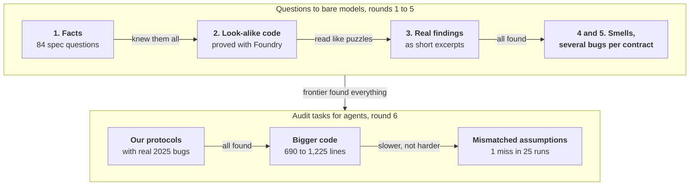

# ETH Evals security research

This repo holds the raw research behind the security domain of [ETH Evals](https://github.com/BuidlGuidl/ethevals): every candidate question and audit task we tried, the model replies, the grading scripts and the tallies. We're not security experts, so we kept the work as it was for anyone to check.

## What we read

Every candidate rests on a real source: a spec, an audit finding, an incident or the compiler's own bug list. The repo cites 90 different sites. These are the main ones:

| Kind | Sources |
| --- | --- |
| Standards and docs | [EIPs](https://eips.ethereum.org), [Solidity docs and bug list](https://docs.soliditylang.org), [OpenZeppelin Contracts](https://github.com/OpenZeppelin/openzeppelin-contracts), [Safe](https://github.com/safe-global/safe-smart-account), [Permit2](https://github.com/Uniswap/permit2), [ERC-4337 EntryPoint](https://github.com/eth-infinitism/account-abstraction) |
| Audit contests | [Code4rena](https://code4rena.com/reports), [Sherlock](https://audits.sherlock.xyz), [CodeHawks](https://codehawks.cyfrin.io), [Immunefi](https://reports.immunefi.com) |
| Audit firms | ChainSecurity, Trail of Bits, OtterSec, Halborn, Dedaub, SlowMist, BlockSec |
| Incidents | [Rekt](https://rekt.news) and the teams' own post-mortems |
| How auditors work | [Pashov Audit Group skills](https://github.com/pashov/skills), [Trail of Bits skills](https://github.com/trailofbits/skills) |
| Other benchmarks | [EVMbench](https://github.com/openai/frontier-evals) by OpenAI and Paradigm, [weird-erc20](https://github.com/d-xo/weird-erc20) |

## How our thinking moved

Each round changed the question based on what the last one showed.



What we take from it: frontier models find these bugs, and so do the latest open models. Bugs we could write and prove in a day seem to sit inside what the models have already seen.

## How much we tried

| | |
| --- | --- |
| Candidate questions | **132**, across 5 rounds |
| Bare-model replies | **1,583**, from Opus 5.5, GPT-6.1-sol, Kimi K3.1 and GLM 5.3 |
| Graded verdicts | **843** by a judge model and **298** by rule |
| Foundry proofs | **75** projects, each proving a candidate's answer |
| Audit tasks | **4** protocols in 7 versions, with 12 planted bugs |
| Agent runs on the audit tasks | **26**, with Claude Code, Codex, Kimi and DeepSeek V4.1 Flash |

Where it landed:

- **13 Concepts questions**, merged in [ethevals#81](https://github.com/BuidlGuidl/ethevals/pull/81). Kimi or GLM missed each one in at least one of three cold tries.
- **4 audit tasks**, in draft [ethevals#83](https://github.com/BuidlGuidl/ethevals/pull/83). No model failed them reliably.

## Round by round

Rounds 1 to 5 asked bare models, with one API call per question. Round 6 ran agents in the ETH Evals runner.

| Round | What we asked | What happened |
| --- | --- | --- |
| 1. Facts | 84 questions on accounts, signatures, tokens, DeFi, upgrades and the EVM | Opus 5.5 and GPT-6.1-sol missed one, a compiler question that all four models got wrong. Twelve caught Kimi or GLM. |
| 2. Behaviour, proved with Foundry | 12 snippets that look like a known bug but behave differently | Open models missed 9 of 12. Frontier models missed 1. |
| 3. Contest excerpts, judged | 6 short excerpts of Code4rena findings: "what is the root cause?" | Every model found nearly all of them. |
| 4. Excerpts with a harmless smell | 18 snippets with a textbook smell next to the real cause | Opus, GPT and Kimi missed none. GLM missed 6. |
| 5. Several bugs in one contract | 12 contracts with 34 issues: "list every issue you would report" | Opus and GPT named every issue. GLM missed whole Highs on 5 contracts. |
| 6. Audit tasks | An agent audits a protocol of ours (540 to 1,350 lines) that carries real 2025 contest bugs, then writes `findings.md` | 25 scored runs across Claude Code, Codex, Kimi and DeepSeek V4.1 Flash. One Kimi run missed one bug. |

The 13 kept questions came from rounds 1 and 2, then three more cold tries per model (`quizzes/*rescreen*`). Every audit-task run is in [audit-tasks/results.md](audit-tasks/results.md).

## Layout

```text
quizzes/                 rounds 1 to 5
├── brief*.md            what each drafting agent was asked, one per round
├── questions*.json      each round's questions
├── replies*.jsonl       every model reply
├── grades*.json         rule verdicts (rounds 1 and 2)
├── judged*.jsonl        judge verdicts (rounds 3 to 5)
├── tally-multi*.txt     round 5 totals
├── pilot*.md            each round's candidates, with sources and proof commands
└── pilot/               one Foundry project per candidate, with its proof
audit-tasks/             round 6
├── plan.md              decisions and results, in order
├── results.md           every trial, one row each (raw rows in rows.jsonl)
├── research/            benchmark and auditor-skill research, and the advisor's two answers
├── trajectories/        how Claude Code and Codex found each bug
├── judge-checks/        the judge tested on reference, near-miss and empty reports
└── briefs/              what each writing agent was asked
```

The audit tasks' code is in [ethevals#83](https://github.com/BuidlGuidl/ethevals/pull/83), under `tasks/build/audit-*`.

## How to check a claim

1. Find the question in its round's `questions*.json` and note its `id`.
2. Look up that `id` in the same round's `replies*.jsonl` and `grades*.json` or `judged*.jsonl`.
3. To check that a bug is real, open the candidate's folder in `quizzes/pilot/`. The round's `pilot*.md` file gives the Foundry command and its passing output.

## Notes

- The files are copied as is from our working folders. Scripts point at `/tmp` paths and won't run unchanged.
- Spend was about $20 for rounds 1 to 5. For round 6, open-model runs cost $3.06 and judge calls $0.69. Claude Code and Codex ran on subscription plans.
- Judges were Opus 5.5, except where a file name says `gpt`.
