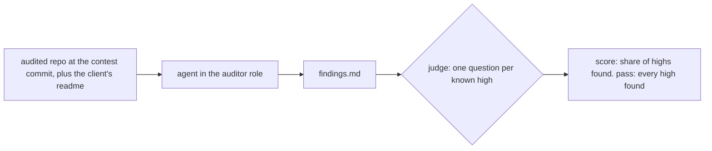

# security tasks: audit real code, check the report found the bugs

claude's plan for the security domain after the quiz rounds. it proposes one task shape. an agent gets a real audited codebase and the client's readme, audits it in the auditor role, and the checks ask whether its report names each known high. no puzzles, no decoys, and false findings go unscored. two researchers fed it (gpt-6.1-sol on audit benchmarks, astra on auditor skills), and fable 5.1 checked it as advisor. nothing has been trialled. the open questions at the end need your call before anything gets built.

## the task

the instruction, as a client would send it (draft):

> You are an expert security researcher and smart contract auditor.
>
> We're about to launch the contracts in `src/` and want an audit before we go live. The README says what the protocol should do, who we trust, and the issues we already know about. Write your findings to `findings.md`, one per issue: where it is, what causes it, what it lets someone do, and how severe you think it is.

the first line is the role line you picked on 10-29 ([[security-quizzes]]). the instruction never says how many bugs there are or what kind.

the checks are one judge question per known high, plus a medium when it's clean, so two to four per task. the judge gets our private description of each bug (function, mechanism, harm) and answers evmbench's question: "Would fixing the vulnerability described in the report also fix the vulnerability in the description?" ([evmbench judge](https://github.com/openai/frontier-evals/blob/main/project/evmbench/evmbench/nano/grade/detect.py)). naming the same contract or the same impact isn't enough. the report has to give severity, but we don't score it.

the bugs are real findings from audit contests or firm reports, at the commit the auditors saw. so the evidence comes with the bug, and nothing is a trick, because real auditors found these in real code. we write a foundry test that proves each finding on that commit. that test is the task's solution, and the agent never sees it.

## how it differs from a dapp-dev task

| | dapp-dev | security |
| --- | --- | --- |
| the ask | a builder's message. the miss is in what they never said | complete: audit this, report what you find |
| where it's hard | doing what a senior dev does unprompted | the code: mapping the protocol, following state across functions and transactions |
| what a check reads | the agent's code or the chain | the agent's report |
| the filter | would a reviewer block the merge? | would the client lose funds, and does finding it take audit work? |

what carries over from [[dapp-dev-meta-doc]]: evidence behind every task, a miss shown in a trial, short instructions, and judge questions that name the code they rest on. the builder story and the "what did it do unprompted" checks don't carry over.

## why this should catch frontier models where the quizzes didn't

before, in the quiz rounds ([[security-quizzes]]), opus 5.5 and gpt-6.1-sol found every isolated ten-line finding in every call. on twelve small contracts with two or three real issues each, both named every issue. glm missed whole highs on five of the twelve, and kimi on one.

after, in whole repos, it looks different. evmbench gives agents the repo a human auditor got, with scopes of 106 to 10,108 lines (median 1,296), and grades recall on 117 real highs ([paper, 3.1 to 3.2](https://arxiv.org/html/2603.04915v1#S3)). the best detect recall was 45.9%, from opus 4.6 in march 2026 ([paper, 4](https://arxiv.org/html/2603.04915v1#S4)), so frontier agents missed about half. today's models are newer and our number will differ. only a trial shows by how much.

the gap comes from size and protocol intent. real codebases have both, and snippets have neither.

## which bugs to pick

this is where the pashov and trail of bits skills come in. cantina hasn't published an audit-agent skill that the researcher could find, so trail of bits stood in for it. both skills tell the auditor agent to map the protocol first and check every path, and pashov's first-principles agent says "Do not pattern-match." ([pashov](https://github.com/pashov/skills/blob/eacfc09b365d2697b83355909d0300607e596ffc/solidity-auditor/references/hacking-agents/first-principles-agent.md)). their methods point at the findings worth a task:

- a value that one function guards and another function writes without the guard ([pashov x-ray](https://github.com/pashov/skills/blob/eacfc09b365d2697b83355909d0300607e596ffc/x-ray/SKILL.md) separates a per-call guard from a property that holds across calls)
- two contracts that each assume the other one checks
- state that goes stale between two transactions, such as a snapshot or a settlement
- a token or oracle that behaves differently from what the accounting assumes
- rounding or fees that become material over repeated calls
- a promise the readme makes, such as solvency or withdrawals, that breaks on one reachable path ([trail of bits spec-to-code](https://github.com/trailofbits/skills/blob/2be6433b39e009cd2b6fd3be1895f6b1faa5af9a/plugins/spec-to-code-compliance/skills/spec-to-code-compliance/SKILL.md))

the list is a guide for reading audit reports. it isn't a recipe for shaping code. the filter that counts is still an open-model miss in a trial.

## how to find one

1. pick a block from the map: lending, vaults, dex, staking, bridges, governance, accounts.
2. find a contest from the last six to nine months with a small scope, under about 1,500 lines, and a high whose story you can follow in ten minutes: the readme says x, this function breaks x, and this party loses money.
3. take the scope as it is. trimming brings back the excerpt every model finds, so pick a small contest over a trimmed big one.
4. probe for contamination. ask a bare model, with the project and file names, what the audit found. if it recites the finding, strip the names and ask again. if it still recites, drop the task.
5. prove the finding with a foundry test on that commit.
6. trial cheaply and offline with a strong agent and an open one, then read what they reported.
7. keep the task when an open model misses a high, and a frontier agent misses one in some trial or finds it only after real reading.

## next to evmbench

evmbench already runs detect, patch and exploit on 40 code4rena audits, so a smaller copy adds nothing. ours adds open agents, glm and kimi in real agents, with trajectories on a public board. it uses 2026 contests on current solidity and none of evmbench's 40. each of the ten to fifteen tasks gets a readme that says what the finding is and who missed it. and the audit tasks sit beside the dapp-dev tasks in the same areas. we'd skip patch and exploit modes, and we wouldn't run a recall leaderboard.

## where fable and claude differed

fable agreed with most of claude's first draft and changed four things. claude took all four.

- no trimming. claude had written "trim only what the finding doesn't touch".
- no proof-of-concept check in batch one. the foundry proof is our solution, not the agent's job.
- "would a pattern-matching pass miss it?" is taste, and a guess until a trial. read carelessly, it leads back to decoys.
- the agent has to be offline, and the runner can't do that yet (next section).

fable's full answer is in `/tmp/subagents/security-audit-tasks/fable-advice.md`, and the two research reports are next to it.

## what blocks the first runner trial

the runner has three modes ([CONTEXT.md](https://github.com/BuidlGuidl/ethevals/blob/main/CONTEXT.md)): vanilla is a bare model with no tools, internet gives the agent the web, and skills is internet plus austin's ethskills pack. with the web, an agent can search for the contest's findings and copy them. so audit tasks need an offline agent mode, which means runner work and an adr. the cheap trials in step 6 can run locally with the network off before that.

## open questions

1. **pillar.** an audit report isn't a quiz, a build or an act as CONTEXT.md defines them. one option is a fourth pillar, audit, added by adr. the other is filing batch one under build and noting the debt. recommend audit, for the security domain. it changes the vocabulary, so carlos should agree too.
2. **offline mode.** one option is an offline agent mode in the runner, with no web and only the repo's local foundry and dependencies, as evmbench does. the other is internet mode with the project renamed, plus a check of trajectories for fetched reports. recommend the offline mode, because with renaming every pass stays in doubt.
3. **false findings.** recommend no scored check in batch one. record claims that contradict the code as an unscored column, since in round five the precision verdict flipped between judges on 36 of 137 rows. later, at most one task could check that the agent doesn't report an issue the readme already lists as known.
4. **skills mode with pashov and trail of bits installed.** fable's idea is the same audit with and without auditor skills, which nobody publishes. it changes the skills pack for every task. recommend waiting until batch one shows a gap. if frontier agents find every high without skills, the comparison says nothing.
5. **first batch.** recommend three tasks from three blocks, taken through a trial before writing more. after your ok, one helper finds candidate contests (steps 1 to 4), and opus writes the foundry proofs, since openai's safeguard cuts codex off when it writes exploit-shaped tests. local trial cost is a guess: about $2 to $5 per open-model trial, so $25 to $60 for three tasks, two open agents and two trials each. frontier agents run on plans.
6. **pr #81.** its thirteen quizzes rest on measured open-model misses. recommend leaving it open as the domain's concepts part and deciding after the first audit tasks land, not reworking it now.

## shiv's calls, [[2026-10-30]]

- don't copy contest repos as they are, since an agent with the web could find them. each task is our own protocol that carries a real finding's mechanism under new names and new code. the real finding stays the evidence.
- pillar is build, in the security domain through the `Audits` area from pr #79. no new pillar.
- no offline mode for now. tasks run in the internet mode.
- false findings stay unscored.
- no skills mode for now. trials use one frontier agent, deepseek 4.1 and kimi k3.1.
- go for volume first, with light research. the tasks are due in an hour. claude started six opus writers, one each for lending, vault, staking, dex, governance and bridge, on branch `security-audit-tasks`.
- batch one landed as draft [pr #83](https://github.com/BuidlGuidl/ethevals/pull/83) with four tasks: staking, governance, vault and dex. safeguards stopped the lending writer on gpt-6.1-sol and the bridge writer on opus and then astra, so those two aren't in it. no trials yet.

## round one, [[2026-10-30]]

claude code, codex and deepseek 4.1 flash each found every known high in all four tasks, with one trial each. kimi found dex's, and its other three trials were still running at the time of writing. claude found each high after a single read in 6 to 9 tool calls. codex reread the contracts and ran tests, but it also had each high before testing. no frontier trajectory searched the web for the original findings. deepseek cost $0.04 to $0.14 a trial. so at about 600 lines a careful read finds everything. shiv picked option b: grow one task (vault) to 1,200 to 1,500 lines with the same bugs and no readme hints, then trial it once on deepseek and claude code. the trial rows are in `/tmp/subagents/security-audit-tasks/ci-results` and the worktree's `results/local-frontier`. the trajectory notes are `trajectories-claude.md` and `trajectories-codex.md` there.

## round two, [[2026-10-30]]

the size test didn't change anything. the grown vault (1,225 lines) was found by claude in 378 s and by deepseek in 710 s for $0.15. claude and fable agree the cause is the kind of bug. each one was a single missing line in one variable, and the writers ported each finding as "a clean contract minus one line". shiv said go on round two:
- plant 3 or 4 mismatched-assumption bugs, each in two pieces of code that are each correct alone, in the vault and dex tasks;
- source them from 2025 and 2026 findings whose root cause reads "x assumed y";
- trial deepseek and kimi twice each on ci and claude code once.

fable's stop rule: if deepseek and kimi find every bug in both trials on both tasks, the audit form can't separate models at our size. pr #83 stays a draft until this round decides.
